<div align="center">

<!-- BANNER -->


<br/>


<h3>A production-grade Zero Trust Identity Governance pipeline built on Microsoft Entra ID</h3>
<p>Automates user lifecycle management, group auditing, log streaming, and threat detection using Graph API, Logic Apps, and Microsoft Sentinel — all on Free/P1 tier.</p>

</div>

---

## 📋 Table of Contents

- [Architecture](#-architecture)
- [What I Built](#-what-i-built)
- [Tech Stack](#-tech-stack)
- [Project Phases](#-project-phases)
- [Screenshots](#-screenshots)
- [Scripts](#-scripts)
- [Sentinel Rules](#-sentinel-analytics-rules)
- [Setup Guide](#-setup-guide)
- [Resume Line](#-resume-line)

---

## 🏗 Architecture

```
┌─────────────────────────────────────────────────────────────────┐
│                    Microsoft Entra ID Tenant                    │
│                                                                 │
│  ┌─────────────────┐    ┌──────────────────┐    ┌───────────┐  │
│  │  Identity Layer │    │ Automation Layer  │    │   SIEM    │  │
│  │                 │    │                  │    │           │  │
│  │ • Users/Groups  │───▶│ • Graph API      │───▶│ Sentinel  │  │
│  │ • App Reg.      │    │ • Logic Apps     │    │ Analytics │  │
│  │ • Audit Logs    │    │ • PowerShell     │    │ Workbooks │  │
│  │ • Sign-in Logs  │    │ • Recurrence     │    │ Incidents │  │
│  └─────────────────┘    └──────────────────┘    └───────────┘  │
│                                  │                              │
│                    Log Analytics Workspace                      │
│                      (law-iam-pipeline)                         │
└─────────────────────────────────────────────────────────────────┘
```

---

## ✅ What I Built

| Component | Description |
|-----------|-------------|
| **Graph API Integration** | Authenticated app registration with client credentials flow |
| **Stale Account Detector** | PowerShell script that identifies inactive accounts via Graph API |
| **Group Membership Audit** | Automated CSV report of all group memberships with empty-group flagging |
| **Logic App Automation** | Weekly scheduled workflow: token → Graph API → email report |
| **Diagnostic Log Streaming** | Entra ID audit/sign-in logs streamed to Log Analytics workspace |
| **Microsoft Sentinel** | SIEM with 2 custom analytics rules and an IAM governance dashboard |

---

## 🛠 Tech Stack

| Technology | Purpose |
|------------|---------|
| Microsoft Entra ID (Azure AD) | Identity provider and IAM platform |
| Microsoft Graph API | Programmatic access to Entra ID data |
| PowerShell | Automation scripting for governance tasks |
| Azure Logic Apps | Serverless workflow automation |
| Azure Log Analytics | Centralized log storage and KQL querying |
| Microsoft Sentinel | Cloud-native SIEM for threat detection |
| KQL (Kusto Query Language) | Analytics rules and dashboard queries |

---

## 🚀 Project Phases

### ✅ Phase 1 — Azure Resource Group
> Created resource group `rg-iam-pipeline` in Central India on Azure for Students subscription.

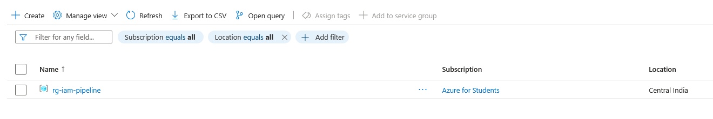

---

### ✅ Phase 2 — App Registration & Graph API
> Registered `IAMGovernancePipeline` app in Entra ID with the following Graph API permissions:
> `User.ReadWrite.All` · `Group.ReadWrite.All` · `AuditLog.Read.All` · `Directory.Read.All`
>
> Verified connectivity by pulling live user data from the tenant via PowerShell.

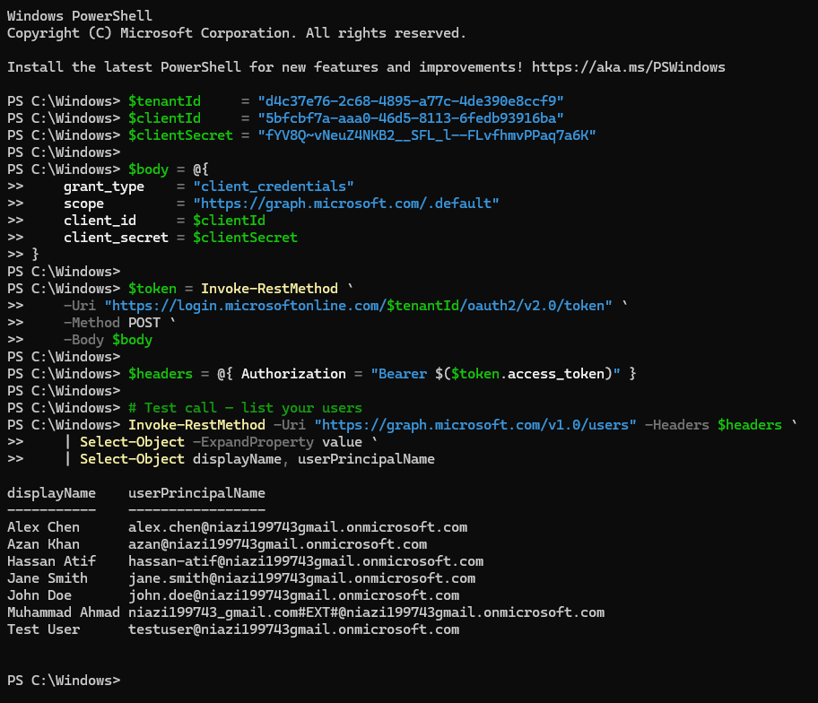

---

### ✅ Phase 3 — PowerShell Governance Scripts

#### Script 1: Stale Account Detector
Queries all users via Graph API, identifies accounts older than 30 days, and optionally disables them — replicating P2 Lifecycle Workflow (leaver automation) on a free tier.

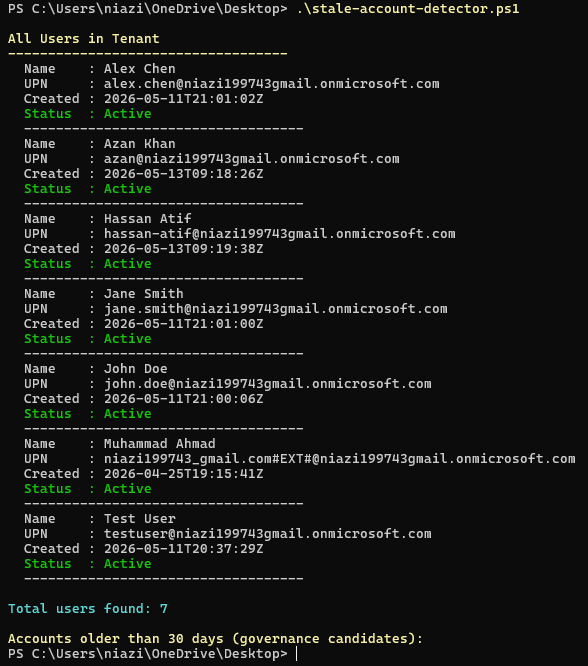

#### Script 2: Group Membership Audit
Enumerates all tenant groups and members, flags empty groups as governance candidates, and exports a full CSV report for review.

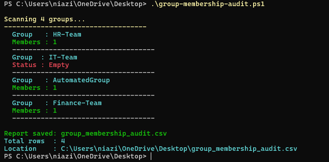

**CSV Output:**

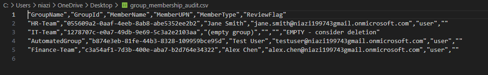

---

### ✅ Phase 4 — Logic Apps Automation
> Built a weekly automated workflow in Azure Logic Apps (Consumption tier):
> `Recurrence` → `Get Access Token` → `Parse Token` → `Get Users (Graph API)` → `Send Email Report`

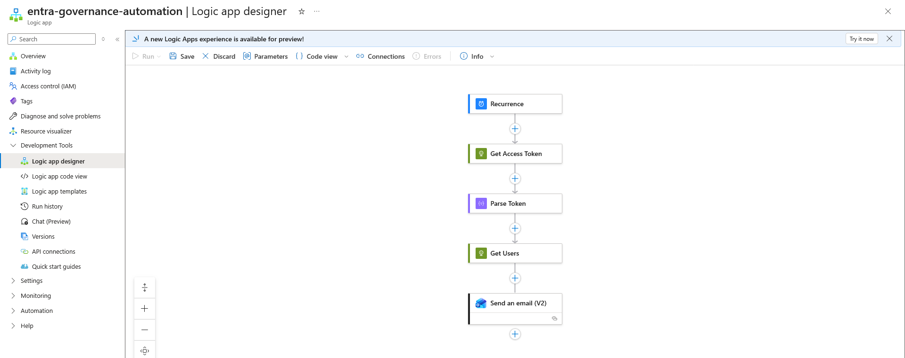

**Workflow ran successfully:**

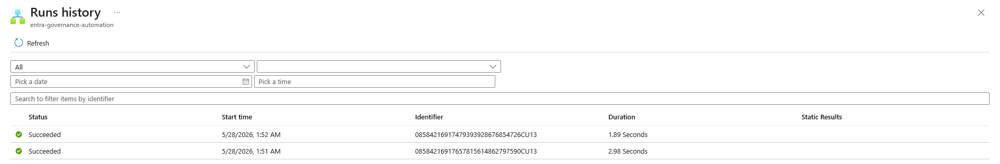

---

### ✅ Phase 5 — Audit Log Export to Log Analytics
> Configured Entra ID Diagnostic Settings to stream logs to `law-iam-pipeline` workspace:
> - ✅ Audit Logs
> - ✅ Sign-In Logs
> - ✅ Non-Interactive User Sign-In Logs
> - ✅ Service Principal Sign-In Logs

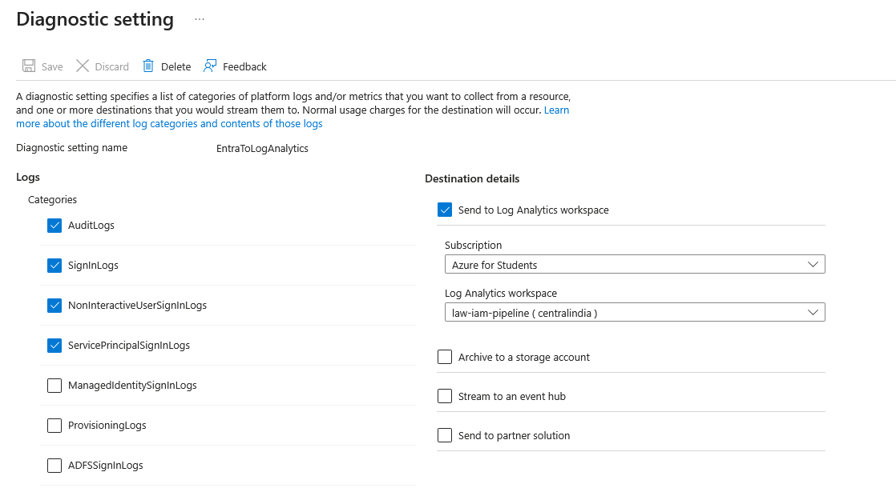

**Log Analytics KQL Query:**

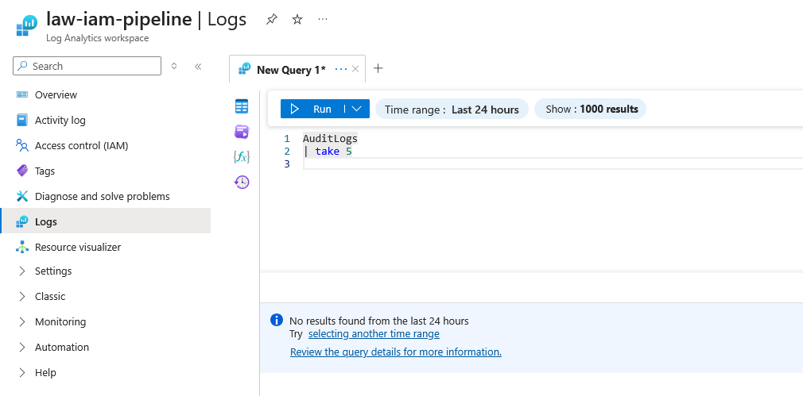

---

### ✅ Phase 6 — Microsoft Sentinel SIEM

**Entra ID Connector — Connected:**

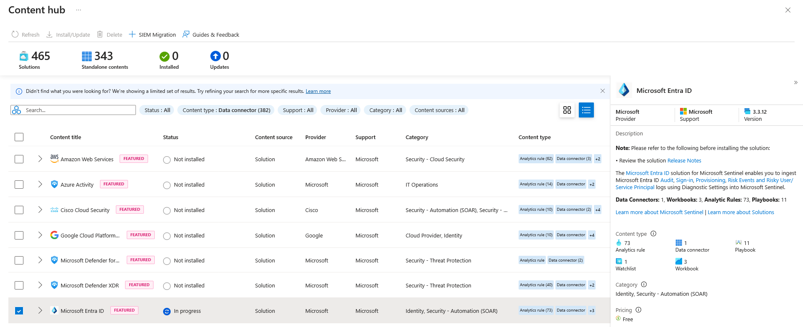

**Analytics Rules — 2 Custom Rules Active:**

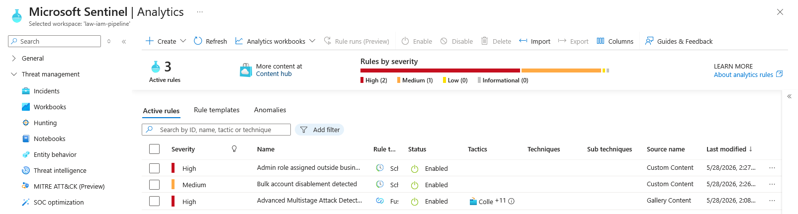

| Rule | Severity | Description |
|------|----------|-------------|
| `Admin role assigned outside business hours` | 🔴 High | Detects role assignments between 6PM–8AM |
| `Bulk account disablement detected` | 🟠 Medium | Triggers when >3 accounts disabled in 10 min |

**KQL Rule Logic:**

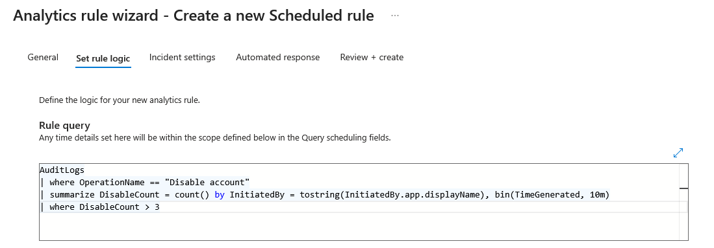

**IAM Governance Dashboard:**

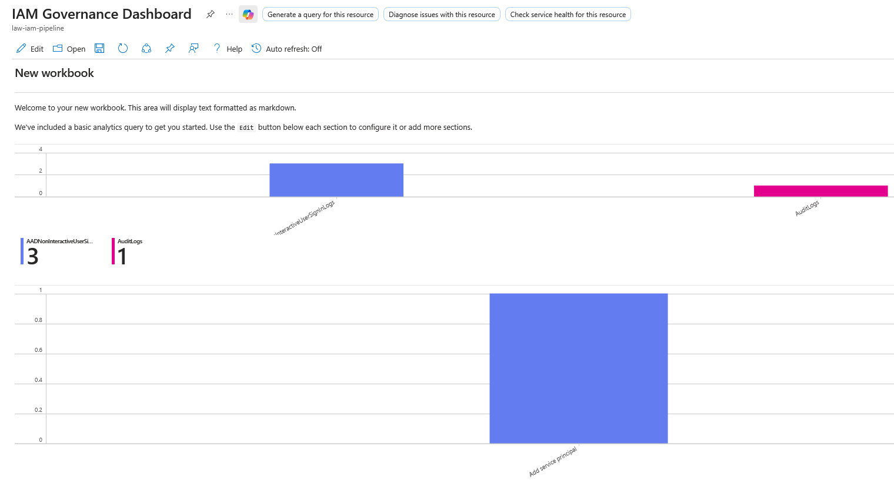

---

## 📁 Scripts

### [`scripts/stale-account-detector.ps1`](scripts/stale-account-detector.ps1)
```powershell
# Identifies inactive Entra ID user accounts via Graph API
# Flags accounts older than 30 days as governance candidates
# Optionally disables them with admin confirmation
```

### [`scripts/group-membership-audit.ps1`](scripts/group-membership-audit.ps1)
```powershell
# Enumerates all tenant groups and their members via Graph API
# Flags empty groups for deletion review
# Exports full audit report to CSV
```

**How to run:**
```powershell
# 1. Set execution policy
Set-ExecutionPolicy -ExecutionPolicy Bypass -Scope CurrentUser -Force

# 2. Run stale account detector
.\scripts\stale-account-detector.ps1

# 3. Run group membership audit
.\scripts\group-membership-audit.ps1
```

> ⚠️ Replace `YOUR_TENANT_ID`, `YOUR_CLIENT_ID`, and `YOUR_SECRET_VALUE` in each script before running.

---

## 🔍 Sentinel Analytics Rules

### [`sentinel/rule-bulk-disable.kql`](sentinel/rule-bulk-disable.kql)
Detects when more than 3 accounts are disabled within a 10-minute window — potential insider threat or compromised admin account.

### [`sentinel/rule-after-hours-role.kql`](sentinel/rule-after-hours-role.kql)
Detects admin role assignments outside business hours (before 8AM or after 6PM) — common indicator of privilege escalation attacks.

### [`sentinel/dashboard-queries.kql`](sentinel/dashboard-queries.kql)
KQL queries powering the IAM Governance Dashboard workbook in Microsoft Sentinel.

---

## ⚙️ Setup Guide

### Prerequisites
- Microsoft Entra ID tenant (free tier is sufficient)
- Azure subscription (Azure for Students works perfectly)
- PowerShell 5.1+

### Quick Start

**1. Clone the repo**
```bash
git clone https://github.com/YOUR_USERNAME/entra-iam-governance.git
cd entra-iam-governance
```

**2. Register an app in Entra ID**
- Go to Azure Portal → Entra ID → App registrations → New registration
- Name: `IAMGovernancePipeline`
- Add Graph API permissions: `User.ReadWrite.All`, `Group.ReadWrite.All`, `AuditLog.Read.All`, `Directory.Read.All`
- Grant admin consent
- Create a client secret

**3. Update credentials in scripts**
```powershell
$tenantId     = "your-tenant-id"
$clientId     = "your-client-id"
$clientSecret = "your-client-secret"
```

**4. Run the scripts**
```powershell
.\scripts\stale-account-detector.ps1
.\scripts\group-membership-audit.ps1
```

**5. Set up Sentinel**
- Create Log Analytics workspace
- Enable Diagnostic Settings in Entra ID → stream to workspace
- Add Microsoft Sentinel to workspace
- Import KQL rules from `sentinel/` folder

---

## 📄 Resume Line

> *"Engineered a Zero Trust Identity Governance pipeline on Microsoft Entra ID using Graph API automation, PowerShell scripting, Logic Apps, audit log streaming to Log Analytics, and Microsoft Sentinel analytics rules for IAM threat detection — deployed on Azure for Students (Free/P1 tier)."*

---

## 👤 Author

**Muhammad Ahmad**
- 🌐 Entra ID Tenant: `niazi1199743gmail.onmicrosoft.com`
- ☁️ Azure Subscription: Azure for Students
- 📍 Rawalpindi, Pakistan

---

<div align="center">


⭐ **If this project helped you, consider giving it a star!**

</div>
